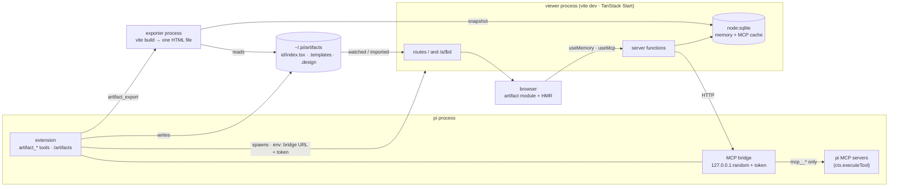
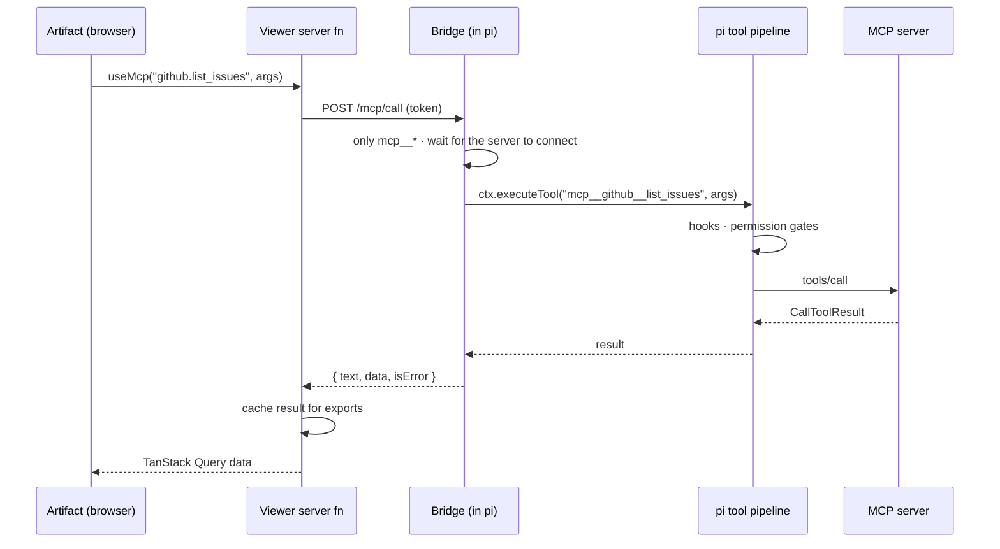

# pi-artifacts

[](https://github.com/tesso57/artifact/actions/workflows/ci.yml)

Live, interactive **React artifacts** for the [pi coding agent](https://pi.dev).
Ask pi for a dashboard, a tool or a prototype; it writes a TSX component and you get a
URL that hot-reloads as the agent iterates.

- **One Vite server, many artifacts** — a single TanStack Start dev server serves every
  artifact as a route (`/a/<id>`), with HMR / React Fast Refresh. No iframes: artifacts
  are real modules in the app.
- **shadcn/ui + TanStack** — shadcn/ui components, plus blocks that compose them with
  TanStack Query and Table v9 (`DataTable`, `QueryState`, `McpQuery`, `StatCard`,
  `ChartCard`, `Page`/`Section`/`Grid`), recharts and lucide icons. Light and dark.
- **SQLite memory** — `useMemory()` persists state (Node's built-in `node:sqlite`); the
  agent reads and writes the same store with `artifact_memory`.
- **MCP from artifacts** — `useMcp("server.tool", args)` calls any MCP server connected to
  pi, through pi's own tool pipeline (hooks and permission gates apply).
- **Single-file export** — `artifact_export` bundles an artifact into one self-contained
  HTML file that works offline (memory and MCP results are snapshotted).
- **Skills, templates and a design system** — three pi skills teach the agent how to
  build artifacts, design reusable templates with you, and maintain a shared look.

```
pi-artifacts/
├── packages/extension/   pi package: tools, /artifacts, MCP bridge, skills + templates
├── packages/core/        shared: artifact/template store, SQLite memory, exporter, bridge types
├── apps/viewer/          TanStack Start app: gallery, artifact route, @pi/artifact SDK,
│                         shadcn/ui, blocks, HTML exporter
└── test/e2e/             real pi session + faux model + stdio MCP server + Playwright
```

## Install

Requires a current Node LTS (22.18+: `node:sqlite`, TypeScript type stripping). CI runs on the latest LTS.

```bash
git clone https://github.com/tesso57/artifact.git pi-artifacts && cd pi-artifacts
npm install
pi install ./packages/extension
```

Or try it without installing: `pi -e ./packages/extension`.

## Use

Ask pi something like _"make an artifact that charts my open GitHub issues per label"_.
The agent loads the `artifacts` skill, starts from a template and calls `artifact_write`;
the footer shows `◆ artifacts http://127.0.0.1:5178`.

| Command | |
|---|---|
| `/artifacts` | pick an artifact (or the gallery) and open it in the browser |
| `/artifacts <id>` | open one artifact |
| `/artifacts export <id> [file.html]` | export as one self-contained HTML file |
| `/artifacts delete <id>` | delete an artifact |
| `/artifacts stop` | stop the viewer |

| Tool (for the agent) | |
|---|---|
| `artifact_write` | create or replace an artifact; returns its URL and compile errors |
| `artifact_memory` | read or write the artifacts' SQLite memory |
| `artifact_template` | list, read, save (compile-checked, with preview) and delete templates |
| `artifact_export` | write one self-contained HTML file |

| Skill | |
|---|---|
| `artifacts` | workflow, rules and references for building artifacts |
| `artifact-template-creator` | interviews you about a use case and builds a reusable template |
| `artifact-design-system` | changes and maintains the shared look (`theme.css` + `DESIGN.md`) |

### Files

| Path | |
|---|---|
| `~/.pi/artifacts/<id>/{index.tsx,meta.json}` | artifacts |
| `~/.pi/artifacts/.memory.sqlite` | memory (and the MCP result cache used by exports) |
| `~/.pi/artifacts/.templates/<name>/{template.tsx,template.json}` | your templates |
| `~/.pi/artifacts/.design/{theme.css,DESIGN.md}` | your design system |

Environment overrides: `PI_ARTIFACTS_DIR`, `PI_ARTIFACTS_DB`, `PI_ARTIFACTS_TEMPLATES`,
`PI_ARTIFACTS_DESIGN`, `PI_ARTIFACTS_PORT` (first port to try, default 5178),
`PI_ARTIFACTS_NODE` (Node binary for child processes).

You can also run the viewer alone (`npm run dev`) to browse artifacts; MCP calls then
report that pi is offline.

## Writing artifacts

An artifact is one TSX module with a default-exported component:

```tsx
import { createColumns, DataTable, McpQuery, Page, PageHeader } from "@/components/blocks";
import { Button } from "@/components/ui/button";
import { useMemory } from "@pi/artifact";

type Issue = { number: number; title: string };
const col = createColumns<Issue>();
const columns = col.columns([col.accessor("number", { header: "#" }), col.accessor("title", { header: "Title" })]);

export default function Issues() {
	const [label, setLabel] = useMemory("label", "bug"); // SQLite-backed state
	return (
		<Page>
			<PageHeader
				title={`Issues: ${label}`}
				actions={<Button variant="outline" onClick={() => setLabel("feature")}>Show features</Button>}
			/>
			{/* MCP via pi, with loading / error / empty states */}
			<McpQuery<Issue[]> tool="github.list_issues" args={{ labels: [label] }}>
				{(issues) => <DataTable data={issues} columns={columns} />}
			</McpQuery>
		</Page>
	);
}
```

### `@pi/artifact`

| API | |
|---|---|
| `useMemory(key, initial, { scope? })` | `[value, setValue, { loading, error }]`, persisted. Scope defaults to the artifact; `"shared"` is shared by all artifacts |
| `useMemoryList({ scope?, prefix? })`, `memory.get/set/delete/list(scope, …)` | lower-level memory access |
| `useMcp(name, args, queryOptions?)` | TanStack Query over an MCP tool: `{ data: { text, data }, isPending, error, refetch }` |
| `useMcpMutation(name)`, `callMcp(name, args)` | on-demand calls |
| `useMcpTools()`, `useMcpStatus()` | available MCP tools; bridge state |
| `useArtifact()`, `runtimeMode` | `{ id, title, description }`; `"live"` or `"static"` (export) |

MCP tool names are `"server.tool"` or `"mcp__server__tool"`. `data` is the server's
`structuredContent`, or the text result parsed as JSON when it looks like JSON.

See [`packages/extension/skills/artifacts`](packages/extension/skills/artifacts) for the
component catalogue, TanStack v9 patterns and the design system.

## How it works



An MCP call from an artifact:



- The bridge listens on loopback with a random token and only runs `mcp__*` tools —
  artifacts cannot reach `bash`, `edit` or `write`.
- MCP calls use the tool context of the latest artifact tool call (`ctx.executeTool`),
  so they go through pi's hooks; before the agent has used an artifact tool in the
  session, MCP calls answer "not ready".
- `artifact_write` asks Vite to transform the module and returns syntax errors and
  unresolved imports to the agent, so it can fix them before you look.
- The viewer starts on first use and stops on `session_shutdown` (and when pi exits).
- `~/.pi/artifacts/.design/theme.css` is appended to the viewer's styles, so token
  overrides reach every artifact and every export.

## Develop

```bash
npm test                 # vitest (core, extension, viewer)
npm run typecheck        # all packages + bundled templates
npm run knip             # unused files, exports and dependencies
npm run check:templates  # render every bundled template in light and dark (Playwright)
npm run test:e2e         # real pi session: write, MCP, memory, theme, templates, export
npm run dev              # viewer alone
```

CI runs all of the above on every push and pull request.
