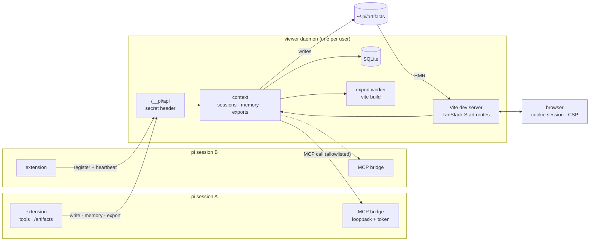
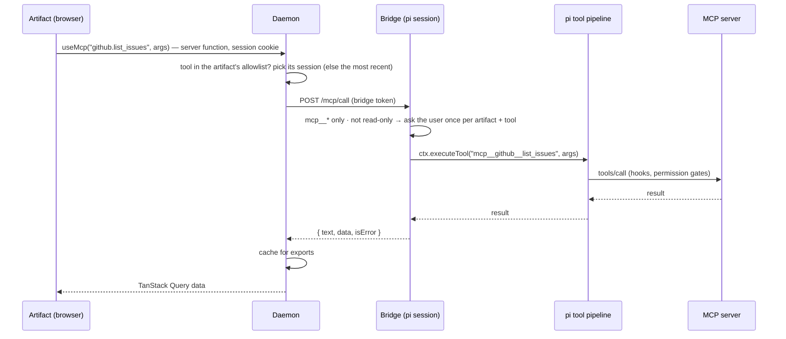

# pi-artifacts

[](https://github.com/tesso57/artifact/actions/workflows/ci.yml)

Live, interactive **React artifacts** for the [pi coding agent](https://pi.dev).
Ask pi for a dashboard, a tool or a prototype; it writes a TSX component and you get a
link that hot-reloads as the agent iterates.

- **One viewer, many artifacts** — a per-user daemon runs a single TanStack Start (Vite)
  dev server; every artifact is a route (`/a/<id>`) with HMR. No iframes: artifacts are
  real modules.
- **shadcn/ui + TanStack** — shadcn/ui components plus blocks that compose them with
  TanStack Query and Table v9 (`DataTable`, `QueryState`, `McpQuery`, `StatCard`,
  `ChartCard`, `Page`/`Section`/`Grid`), recharts and lucide icons. Light and dark.
- **SQLite memory** — `useMemory()` persists state; the agent reads and writes the same
  store with `artifact_memory`.
- **MCP from artifacts** — `useMcp("server.tool", args)` calls MCP servers connected to
  pi, limited to the artifact's allowlist, with approval for tools that change things.
- **Feedback for the agent** — `artifact_write` returns compile errors and the runtime
  errors of an open browser tab.
- **Single-file export** — one self-contained HTML file that works offline (memory and
  MCP results are snapshotted; the tool lists what was embedded).
- **Skills, templates and a design system** — three pi skills teach the agent to build
  artifacts, design reusable templates with you, and maintain a shared look.

## Install

Requires a current Node LTS (22.18+). CI runs on the latest LTS.

```bash
pi install git:github.com/tesso57/artifact
```

Or from a checkout: `npm install`, then `pi install ./` (or `pi -e ./` to try it once).

## Use

Ask pi something like _"make an artifact that charts my open GitHub issues per label"_.
The agent loads the `artifacts` skill, starts from a template and calls `artifact_write`,
which prints an **Open** link (it signs your browser in to the viewer; valid 30 minutes).

| Command | |
|---|---|
| `/artifacts` | pick an artifact (or the gallery) and open it |
| `/artifacts <id>` | open one artifact |
| `/artifacts export <id> [file.html]` | export as one self-contained HTML file |
| `/artifacts delete <id>` | delete an artifact, its files and its memory |
| `/artifacts stop` | stop the viewer (for all pi sessions) |

| Tool (for the agent) | |
|---|---|
| `artifact_write` | create or replace an artifact (`mcp` = its MCP allowlist); returns the link, compile and runtime errors |
| `artifact_memory` | read or write artifact memory |
| `artifact_template` | list, read, save (compile-checked, preview link) and delete templates |
| `artifact_export` | write one self-contained HTML file and report what it embeds |

| Skill | |
|---|---|
| `artifacts` | workflow, rules and references for building artifacts |
| `artifact-template-creator` | interviews you about a use case and builds a reusable template |
| `artifact-design-system` | changes and maintains the shared look (`theme.css` + `DESIGN.md`) |

### Files and settings

| Path | |
|---|---|
| `~/.pi/artifacts/<id>/{index.tsx,meta.json}` | artifacts |
| `~/.pi/artifacts/.templates/<name>/` | your templates |
| `~/.pi/artifacts/.design/{theme.css,DESIGN.md}` | your design system |
| `~/.pi/artifacts/.state/` | daemon state: `memory.sqlite`, `viewer.json` (port, secret), `viewer.log` — never served |
| `~/.pi/artifacts/.runtime/` | daemon sources copied out of `node_modules` for npm installs |

| Variable | |
|---|---|
| `PI_ARTIFACTS_DIR` | root folder (default `~/.pi/artifacts`); also `PI_ARTIFACTS_TEMPLATES`, `PI_ARTIFACTS_DESIGN`, `PI_ARTIFACTS_STATE`, `PI_ARTIFACTS_DB`, `PI_ARTIFACTS_RUNTIME` |
| `PI_ARTIFACTS_PORT` | first port to try (default 5178) |
| `PI_ARTIFACTS_IDLE_MS` | the daemon exits after this long without sessions or requests (default 15 min) |
| `PI_ARTIFACTS_MCP_APPROVAL` | `allow` or `deny` MCP tools that are not read-only without asking (default: ask; deny without a UI) |
| `PI_ARTIFACTS_NODE` | Node binary for the daemon (when pi runs as a Bun binary without `node` on PATH) |

## Writing artifacts

```tsx
import { createColumns, DataTable, McpQuery, Page, PageHeader } from "@/components/blocks";
import { Button } from "@/components/ui/button";
import { useMemory } from "@pi/artifact";

type Issue = { number: number; title: string };
const col = createColumns<Issue>();
const columns = col.columns([col.accessor("number", { header: "#" }), col.accessor("title", { header: "Title" })]);

// written with artifact_write({ …, mcp: ["github.list_issues"] })
export default function Issues() {
	const [label, setLabel] = useMemory("label", "bug"); // SQLite-backed state
	return (
		<Page>
			<PageHeader
				title={`Issues: ${label}`}
				actions={<Button variant="outline" onClick={() => setLabel("feature")}>Show features</Button>}
			/>
			<McpQuery<Issue[]> tool="github.list_issues" args={{ labels: [label] }}>
				{(issues) => <DataTable data={issues} columns={columns} />}
			</McpQuery>
		</Page>
	);
}
```

| `@pi/artifact` | |
|---|---|
| `useMemory(key, initial, { scope? })` | `[value, setValue, { loading, error }]`, persisted; `"shared"` scope is shared by all artifacts |
| `useMemoryList`, `memory.get/set/delete/list` | lower-level memory access |
| `useMcp(name, args, queryOptions?)` | TanStack Query over an MCP tool: `{ data: { text, data } }` |
| `useMcpMutation(name)`, `callMcp(name, args)` | on-demand calls |
| `useMcpTools()`, `useMcpStatus()` | available tools (with `readOnly`); whether pi is connected |
| `useArtifact()`, `runtimeMode` | `{ id, title, description }`; `"live"` or `"static"` (export) |

See [`skills/artifacts`](skills/artifacts) for the component catalogue, TanStack v9
patterns and the design system.

## How it works



An MCP call from an artifact:



### Security model

- The viewer listens on 127.0.0.1. Every request needs a session cookie (set by an Open
  link: random, short-lived token → HttpOnly, SameSite=Strict cookie) or, for the
  extension, the daemon secret header. State-changing browser requests must be
  same-origin. The extension API (`/__pi/api`) does not accept the cookie.
- A Content Security Policy keeps artifacts from loading or sending anything outside the
  viewer (`connect-src 'self'`). Daemon state (SQLite, secret) is never served.
- Artifacts share one origin, so memory scopes are a convention, not a sandbox: an
  artifact can read another artifact's memory. Treat artifacts like any other code the
  agent writes.
- MCP calls are limited to the artifact's allowlist, only `mcp__*` tools are reachable,
  tools that are not read-only need approval, and every call goes through pi's hooks.

### Lifecycle

- The first artifact tool (or `/artifacts`) starts the daemon; later pi sessions join it.
  It stops itself after 15 idle minutes without sessions, or with `/artifacts stop`.
- Sessions register their MCP bridge and send heartbeats; an artifact's MCP calls go to
  the session that wrote it, else to the most recently active one. MCP works once the
  agent has used an artifact tool in that session.
- A newer extension version replaces an older running daemon.

## Develop

```bash
npm test                 # vitest: store, memory, protocol, sessions, API security, bridge, tools
npm run typecheck        # viewer, extension, tests and bundled templates
npm run knip             # unused files, exports and dependencies
npm run check:templates  # render every bundled template in light and dark (Playwright)
npm run test:e2e         # real pi sessions: write, MCP, approval, runtime errors, memory, export, templates
npm run test:pack        # npm pack → install into node_modules → the e2e suite against that copy
npm run dev              # the viewer daemon in the foreground (prints an Open link)
```

CI runs all of this on Linux (latest Node LTS) and the unit tests on Windows.
