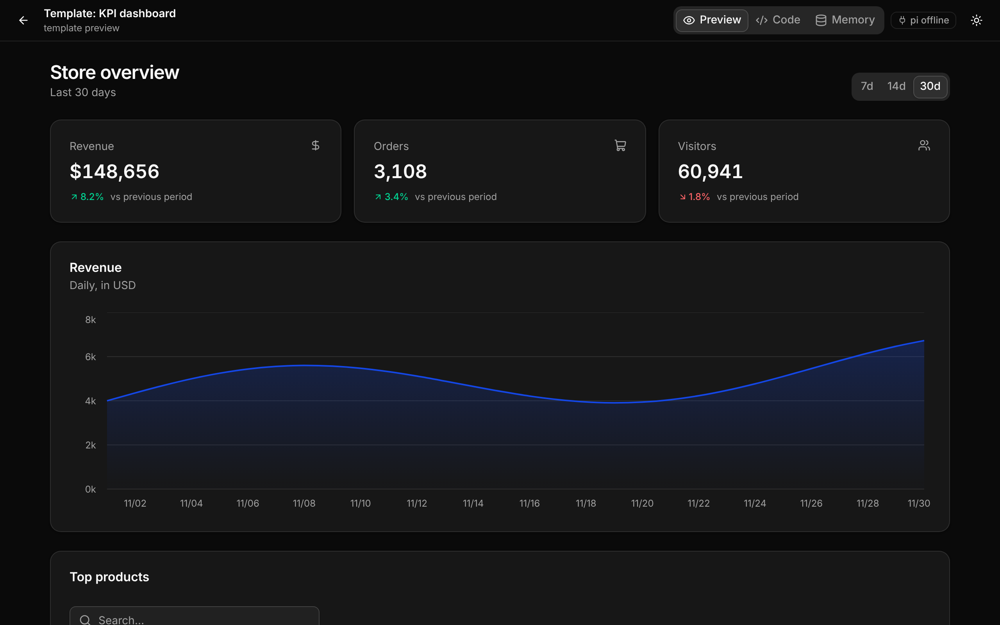
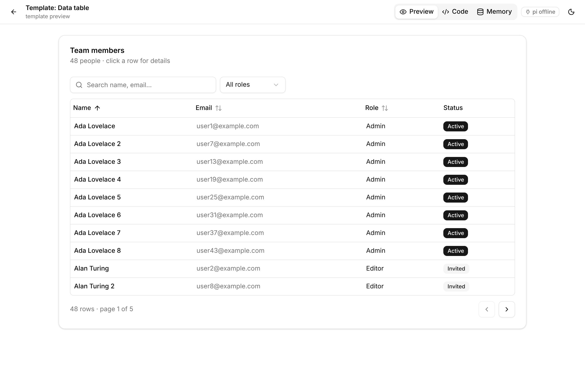
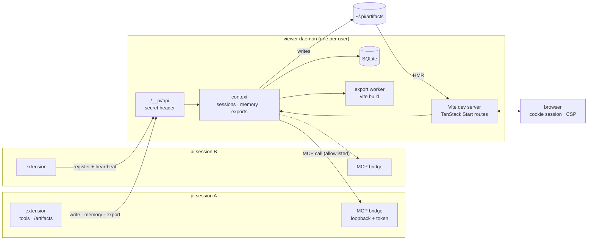

# pi-artifacts

[](https://github.com/tesso57/artifact/actions/workflows/ci.yml)

Live, interactive **React artifacts** for the [pi coding agent](https://pi.dev).
Ask pi for a dashboard, a tool or a prototype; it writes a TSX component and you get a
link that hot-reloads as the agent iterates.

| KPI dashboard (dark) | Data table (light) |
|---|---|
|  |  |

<sub>Two of the bundled templates, as the viewer renders them. The [style guide](docs/images/style-guide-light.png) shows every token and component.</sub>

- **One viewer, many artifacts** — a per-user daemon runs a single TanStack Start (Vite)
  dev server; every artifact is a route (`/a/<id>`) with HMR. No iframes: artifacts are
  real modules.
- **shadcn/ui + TanStack** — shadcn/ui components plus blocks that compose them with
  TanStack Query and Table v9 (`DataTable`, `QueryState`, `McpQuery`, `StatCard`,
  `ChartCard`, `Page`/`Section`/`Grid`), recharts and lucide icons. Light and dark.
- **Project timelines and Markdown** — `GanttChart` shows inclusive task dates and
  progress; `Markdown` renders GitHub-flavored Markdown, including tables and task lists.
- **Mermaid first for diagrams** — `<Mermaid>` / `<DiagramCard>` render architecture,
  sequence, state, ER and other diagrams in the theme; the agent is told to prefer them
  over hand-built visuals, with a `diagram` template to start from.
- **SQLite memory** — `useMemory()` persists state; the agent reads and writes the same
  store with `artifact_memory`.
- **MCP from artifacts** — `useMcp("server.tool", args)` calls MCP servers connected to
  pi, limited to the artifact's allowlist, with approval for tools that change things.
- **Feedback for the agent** — `artifact_write` returns compile errors and the runtime
  errors of an open browser tab.
- **Single-file export** — one self-contained HTML file that works offline (memory and
  MCP results are snapshotted; the tool lists what was embedded).
- **Skills, templates and a design system** — three pi skills teach the agent to build
  artifacts, design reusable templates with you, and maintain a shared look.

## Install

Requires Node.js 22.19.0 or later and pi. The extension is tested with pi 1.5.0;
development and CI use the Node version pinned in `.nvmrc` (26.13.0).

```bash
pi install git:github.com/tesso57/artifact
```

Or from a checkout: `npm install`, then `pi install ./` (or `pi -e ./` to try it once).

## Use

Ask pi something like _"make an artifact that charts my open GitHub issues per label"_.
The agent loads the `artifacts` skill, starts from a template and calls `artifact_write`,
which prints an **Open** link. It signs a browser on the same machine in to the local
viewer, works once, and expires after 30 minutes. If it has already been used or expired,
ask pi for a fresh link with `artifact_link`, or use `/artifacts` to open it again.
For someone on another machine, export a single HTML file instead; it includes the
snapshotted memory and MCP results reported by the export tool, so review them before sharing.

| Command | |
|---|---|
| `/artifacts` | pick an artifact (or the gallery) and open it |
| `/artifacts <id>` | open one artifact |
| `/artifacts export <id> [file.html]` | export as one self-contained HTML file |
| `/artifacts delete <id>` | delete an artifact, its files and its memory |
| `/artifacts stop` | stop the viewer (for all pi sessions) |

For `/artifacts export`, the text after the ID is the file path; spaces do not require shell quoting.

| Tool (for the agent) | |
|---|---|
| `artifact_write` | create or replace an artifact (`mcp` = its MCP allowlist); returns the link, compile and runtime errors |
| `artifact_link` | get a fresh, one-use link to an existing artifact without changing it |
| `artifact_memory` | read or write artifact memory |
| `artifact_template` | list, read, save (compile-checked, preview link) and delete templates; deletion clears that user template's preview data |
| `artifact_export` | write one self-contained HTML file and report what it embeds |

| Skill | |
|---|---|
| `artifacts` | workflow, rules and references for building artifacts |
| `artifact-template-creator` | interviews you about a use case and builds a reusable template |
| `artifact-design-system` | changes and maintains the shared look (`theme.css` + `DESIGN.md`) |

### Files and settings

| Path | |
|---|---|
| `~/.pi/artifacts/<id>/{index.tsx,meta.json}` | artifacts |
| `~/.pi/artifacts/.templates/<name>/` | your templates |
| `~/.pi/artifacts/.design/{theme.css,DESIGN.md}` | your design system |
| `~/.pi/artifacts/.state/` | daemon state: `memory.sqlite`, `viewer.json` (port, secret), `viewer.log` — never served |
| `~/.pi/artifacts/.runtime/` | daemon sources copied out of `node_modules` for npm installs |
| `~/.pi/artifacts/.vite-cache/` | generated viewer dependency caches, isolated by daemon state directory |

| Variable | |
|---|---|
| `PI_ARTIFACTS_DIR` | root folder (default `~/.pi/artifacts`); also `PI_ARTIFACTS_TEMPLATES`, `PI_ARTIFACTS_DESIGN`, `PI_ARTIFACTS_STATE`, `PI_ARTIFACTS_DB`, `PI_ARTIFACTS_RUNTIME` |
| `PI_ARTIFACTS_PORT` | first port to try (default 5178) |
| `PI_ARTIFACTS_IDLE_MS` | the daemon exits after this long without sessions or requests, once no unused links remain (default 15 min) |
| `PI_ARTIFACTS_MCP_APPROVAL` | `allow` or `deny` MCP tools that are not read-only without asking (default: ask; deny without a UI) |
| `PI_ARTIFACTS_NODE` | Node binary for the daemon (when pi runs as a Bun binary without `node` on PATH) |

If an artifact or template directory contains `#`, `?`, or `%`, the viewer uses private
temporary directory links to support relative imports. If the operating system prevents
creating those links, it falls back to self-contained TSX files for such paths.
When the runtime-copy directory contains those characters, runtime sources are cached in
a private system temporary directory instead and recreated if the system removes them.

## Writing artifacts

```tsx
import { createColumns, DataTable, McpQuery, Page, PageHeader } from "@/components/blocks";
import { Button } from "@/components/ui/button";
import { useMemory } from "@pi/artifact";

type Issue = { number: number; title: string };
const col = createColumns<Issue>();
const columns = col.columns([col.accessor("number", { header: "#" }), col.accessor("title", { header: "Title" })]);

// written with artifact_write({ …, mcp: ["github.list_issues"] })
export default function Issues() {
	const [label, setLabel] = useMemory("label", "bug"); // SQLite-backed state
	return (
		<Page>
			<PageHeader
				title={`Issues: ${label}`}
				actions={<Button variant="outline" onClick={() => setLabel("feature")}>Show features</Button>}
			/>
			<McpQuery<Issue[]> tool="github.list_issues" args={{ labels: [label] }}>
				{(issues) => <DataTable data={issues} columns={columns} />}
			</McpQuery>
		</Page>
	);
}
```

For a project timeline and brief, use the bundled
[`project-plan` template](skills/artifacts/templates/project-plan/template.tsx). Its
`GanttChart` takes tasks with an `id`, `label`, `start` and `end` (`YYYY-MM-DD`),
and optional `progress` from 0 to 100. `Markdown` takes a string as its children and
ignores raw HTML. Both work in the viewer and offline exports.

| `@pi/artifact` | |
|---|---|
| `useMemory(key, initial, { scope? })` | `[value, setValue, { loading, error }]`, persisted; `"shared"` scope is shared by all artifacts |
| `useMemoryList`, `memory.get/set/delete/list` | lower-level memory access |
| `useMcp(name, args, queryOptions?)` | TanStack Query over an MCP tool: `{ data: { text, data } }` |
| `useMcpMutation(name)`, `callMcp(name, args)` | on-demand calls |
| `useMcpTools()`, `useMcpStatus()` | available tools (with `readOnly`); whether pi is connected |
| `useArtifact()`, `runtimeMode` | `{ id, title, description }`; `"live"` or `"static"` (export) |

`useMemory` functional updates detect conflicts with other tabs and agent writes and retry
against the latest value, so updater functions must be pure. Exported HTML uses IndexedDB to
coordinate writes across tabs; if it is unavailable, writes report an error rather than risk
overwriting data. Direct assignments replace the current value.

`useMcp` does not retry or refetch automatically on remount, focus or reconnect by default:
a failed call may already have acted. Enable those query options only for tools that are safe to repeat.

See [`skills/artifacts`](skills/artifacts) for the component catalogue, TanStack v9
patterns and the design system.

## How it works



An MCP call from an artifact:


### Security model

What is protected:

- **Other programs and websites.** The viewer listens on 127.0.0.1. Browsers get in only
  through an Open link: a one-time token (30 minutes) that becomes a random session
  cookie (HttpOnly, SameSite=Strict) — never the daemon's secret. The extension's API
  (`/__pi/api`) only takes the secret header (state file is `0600`, state folder `0700`).
  State-changing browser requests must be same-origin, and Vite's editor endpoint is
  blocked.
- **Your files.** The viewer serves only its own sources, its dependencies, artifacts and
  templates. Daemon state (SQLite, lock, secret, log) is never served.
- **MCP tools.** Only `mcp__*` tools are reachable, every call goes through pi's tool
  pipeline (hooks, permission gates), and a tool runs without asking only when its server
  marks it read-only and closed-world; anything else asks you once per tool per session.

What is not (artifacts are code the agent wrote, running in your browser):

- **Artifacts are not isolated from each other.** They share one origin, so an artifact
  can read another artifact's memory, and the per-artifact `mcp` allowlist only prevents
  mistakes — a malicious artifact can claim another's id. Approval is therefore per
  tool, not per artifact, and there is no "allow every tool" (`*`) pattern.
- **The CSP reduces, but does not stop, exfiltration.** `connect-src 'self'` blocks
  `fetch`/WebSocket to other hosts, but a script can still navigate the page elsewhere.
  Render MCP results as text (React does this by default), not as HTML.
- Exported HTML files carry a CSP that blocks `fetch`, images and other loads from the
  network; as in the viewer, a script could still navigate away, so share exports of
  artifacts you trust.

### Lifecycle

- The first artifact tool (or `/artifacts`) starts the daemon; later pi sessions join it.
  It stops itself after 15 idle minutes without sessions or unused links, or with `/artifacts stop`.
  Explicitly stopping or replacing the daemon invalidates its outstanding links.
- Sessions register their MCP bridge and send heartbeats; an artifact's MCP calls go to
  the session that wrote it if it can run the tool, otherwise to the most recently joined
  session that can. MCP works once the agent has used an artifact tool in that session.
- Rewriting an artifact clears its saved MCP results. Open the new version and wait for
  its data to load before exporting; pending or failed calls have no offline result.
- Exports refuse to replace an existing file unless `overwrite` is explicitly enabled.
  Replacement writes the new file before swapping it into place. If the destination is a
  symbolic link, the link itself is replaced and its target is left unchanged.
  Creating a new export uses a hard link to publish the completed file without replacing
  an existing destination; the destination filesystem must support hard links.
- A newer extension version replaces an older running daemon.
- A live PID in `viewer.lock/pid` (or a legacy `viewer.lock` file) is not automatically removed, even when the viewer is
  temporarily unresponsive. If a PID was reused after a crash or reboot, verify that it
  belongs to an unrelated process before removing the stale lock file.
- Updated daemons keep `viewer.lock` as a directory across stops. Together with
  `viewer.lock.gate.sqlite`, it prevents an older daemon's file-only removal from deleting
  the updated lock. Old daemons do not use the gate, so stop every old session before upgrading.

Before updating from an older version, stop the viewer with `/artifacts stop`, then close
all old pi sessions. Update the package and start pi only after they have exited. If a stale
legacy `viewer.lock` file remains, the viewer asks for manual recovery: verify that no old
session or viewer remains, then remove that file and retry. Version 0.4 uses viewer protocol 2;
an older client cannot use the new viewer and must be updated. Do not remove
`viewer.lock.gate.sqlite` or its SQLite journal while a viewer may be running: deleting
the gate file can bypass its lock. If recovery is necessary, first stop all pi sessions
and confirm that no viewer process remains.

To return to an older version, first stop all pi sessions and viewers, then remove the
`viewer.lock` directory. Older versions cannot use the new lock format and retain their
original concurrent stale-lock recovery behavior.

## Develop

```bash
npm test                 # vitest: store, memory, protocol, sessions, API security, bridge, tools
npm run typecheck        # viewer, extension, tests and bundled templates
npm run knip             # unused files, exports and dependencies
npm run check:package    # verify npm pack includes runtime sources and pi entry points
npm run check:templates  # render every bundled template in light and dark (Playwright)
npm run test:e2e         # real pi sessions: write, MCP, approval, runtime errors, memory, export, templates
npm run test:pack        # npm pack → install into node_modules → the e2e suite against that copy
npm run dev              # the viewer daemon in the foreground (prints an Open link)
```

CI uses the pinned Node version on Linux and Windows and runs unit and browser tests on
Node 22.19 on Linux. It also checks the Pi loader and package contents, runs installed-package
tests on Linux, and tests the daemon with Node 23.0.
